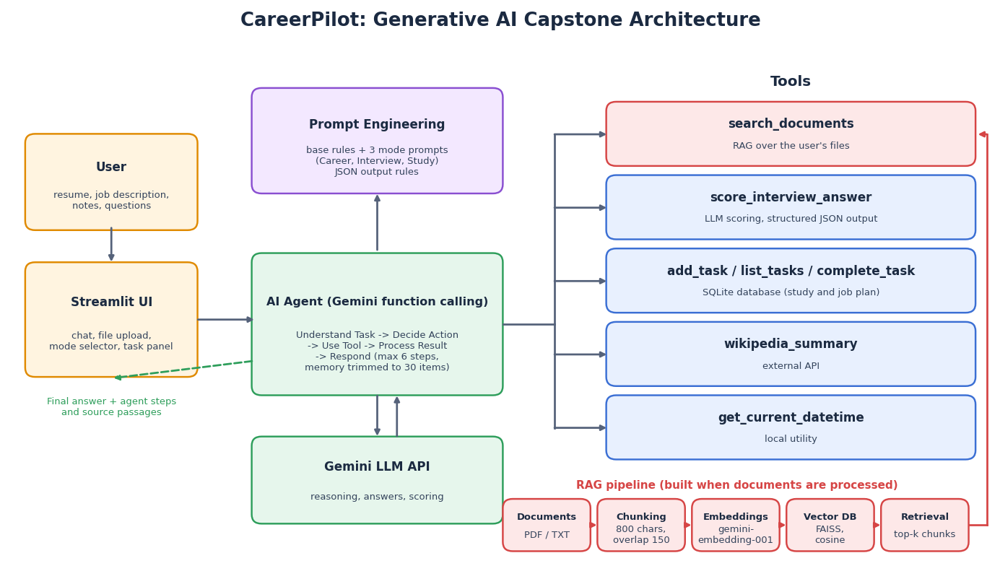

# CareerPilot: AI Career & Study Assistant

Generative AI Capstone project of the Virtual Internship at **Codomax Digital Solutions**.

**Author:** Tarun Upadhyay

- **Live app:** PASTE_YOUR_LIVE_LINK_HERE
- **Demo video:** PASTE_YOUR_VIDEO_LINK_HERE

CareerPilot helps students and freshers prepare for jobs. Upload your resume, a job description or study notes, then chat with an AI agent that can compare them, run a mock interview, score your answers and build a study plan.



## What the capstone combines
| Requirement | How it is used in CareerPilot | File |
|---|---|---|
| **LLM API** | Gemini generates answers, reasoning and scoring | `agent.py`, `rag.py` |
| **Prompt engineering** | A base prompt with rules, plus a separate prompt for each mode (Career Coach, Interview Coach, Study Helper), and JSON output for scoring | `agent.py` |
| **RAG** | Documents are chunked, embedded and stored in a FAISS vector database; relevant chunks are retrieved with sources | `rag.py` |
| **Tools** | Document search, interview scorer, Wikipedia API, date/time, and a SQLite task database | `agent.py` |
| **Agent** | A function-calling loop: understand, decide, use tool, process result, respond, with up to 6 steps | `agent.py` |

## Features
- **Career Coach:** compares your resume with a job description and lists matching skills, missing skills and improvements.
- **Interview Coach:** asks one question at a time based on the job and your resume, scores each answer out of 10 and gives feedback.
- **Study Helper:** explains topics using your notes, creates quizzes, and turns a study plan into tasks.
- **Agent steps panel:** shows every tool call, its input and its result under each answer.
- **Task panel:** shows the study and application plan stored in the database.

## How it works
1. **Documents:** PDF, TXT or MD files are read page by page.
2. **Chunking:** text is split into overlapping chunks (default 800 characters, 150 overlap).
3. **Embeddings:** each chunk is converted into a vector with `gemini-embedding-001`.
4. **Vector DB:** vectors are stored in FAISS and searched by cosine similarity.
5. **Agent:** the model reads the request and decides which tool to call. For questions about your files it calls `search_documents`, which returns the top matching chunks.
6. **Answer:** the model combines tool results into a short answer that mentions its sources.

## Tools
| Tool | Purpose | Type |
|---|---|---|
| `search_documents` | Finds relevant passages in the uploaded files | RAG |
| `score_interview_answer` | Scores an answer with strengths and improvements (JSON) | LLM + structured output |
| `wikipedia_summary` | Background facts about a topic | External API |
| `get_current_datetime` | Current date and time | Local |
| `add_task`, `list_tasks`, `complete_task` | Study and application plan | SQLite database |

## Memory, safety and limitations
- **Memory:** the conversation (including tool calls) is kept per user session and trimmed to the latest 30 items.
- **Safety:** tools come from a fixed allow-list; there is no tool that deletes data or sends messages; a step limit stops endless loops; tool errors are returned as text so the agent can recover; each session has its own database.
- **Privacy:** documents stay in memory for the session and are not saved. Do not upload sensitive personal documents to a public demo.
- **Limitations:** scanned PDFs need OCR, answers can still be wrong so important facts should be verified, tasks and documents are lost when the app restarts, and the free API quota limits heavy use.

## Project structure
```
.
├── app.py                      # Streamlit user interface
├── agent.py                    # Prompts, tools and the agent loop
├── rag.py                      # Loading, chunking, embeddings, vector DB, retrieval
├── requirements.txt
├── architecture.png            # Architecture diagram
├── sample_resume.txt           # Sample file for the demo
├── sample_job_description.txt  # Sample file for the demo
├── DEMO_SCRIPT.md              # Script for the demo video
└── README.md
```

## Setup
1. Install packages:
   ```
   pip install -r requirements.txt
   ```
2. Create a file named `.env` in the project folder (never upload it to GitHub):
   ```
   GEMINI_API_KEY=your_api_key_here
   ```
3. Run the app:
   ```
   streamlit run app.py
   ```
4. Upload `sample_resume.txt` and `sample_job_description.txt`, click **Process documents**, and try the example prompts.

## Deployment
Deployed on Streamlit Community Cloud. The API key is stored in the app's Secrets (`GEMINI_API_KEY`), not in the code.

## Screenshots
Add 2-3 screenshots here (Career Coach comparison, Interview Coach scoring, Agent steps panel).

## Future improvements
- OCR for scanned PDFs
- Saving documents and tasks between sessions
- Resume export as PDF
- Streaming answers and voice input

## Key learnings
- RAG grounds answers in the user's own documents and reduces hallucinations.
- Making RAG a tool lets the agent decide when to search and what to search for.
- Separate prompts per mode change behaviour without changing the code.
- Safety limits, error handling and clear sources make an AI app trustworthy.
